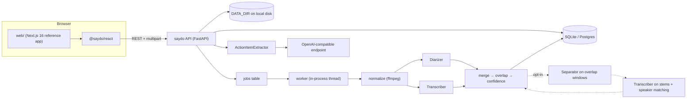

# SayDo — Design Spec

**Date:** 2026-10-09
**Status:** Draft for review
**One line:** Self-hosted, open-source tool that turns a recorded multi-speaker meeting into a speaker-labelled transcript (with honest overlap handling) and then into per-person action items.

---

## 1. Goals and non-goals

### Goals
- **Phase 1:** Record or upload a meeting, then:
  - transcribe it and diarize it ("Speaker 1…N");
  - detect overlapping speech and represent it explicitly;
  - give every segment a confidence score and flag doubtful segments for review;
  - let the user rename speakers, reassign segments and merge speakers.
- **Phase 2:** Extract tasks, decisions and next steps, grouped by owner (including "Unassigned"). Each item has a description, deadline and a source timestamp. Items built on doubtful segments are marked `needs_review`.
- **Reusable:** usable by any team and embeddable in another app (an internal chatbot) through a REST API and a React component package.
- **Pluggable models:** the transcriber, diarizer, separator and extractor can be swapped through configuration without forking.
- **Local by default:** no data leaves the host unless the operator configures a remote LLM endpoint.

### Non-goals (v1)
- Live/streaming transcription during the meeting (processing is batch, after recording).
- Recognising the same person across meetings (voice enrollment).
- Multi-tenant user management and auth (the host app owns auth; SayDo accepts a static bearer token).
- Resumable/chunked uploads; mic-array beamforming.

---

## 2. Assumptions
| # | Assumption | Consequence if wrong |
|---|---|---|
| A1 | English first; Whisper's multilingual ability is available but only English is evaluated | Other languages work but have unmeasured accuracy |
| A2 | 2–8 speakers, meetings up to 2 h | Beyond 8 speakers, speaker confusion rises sharply |
| A3 | A single machine; NVIDIA GPU recommended; CPU supported; Apple Silicon partially accelerated (pyannote on MPS) | CPU-only processing of a 1 h meeting is about 30–90 min |
| A4 | Speakers are anonymous for each recording | No cross-meeting identity |
| A5 | Project license is Apache-2.0 | — |
| A6 | Overlap strategy A (overlap-aware diarization) is the default. Strategy B (separation on overlap windows) is an opt-in plugin, turned on by default only if M5 shows a cpWER gain | — |

---

## 3. Expected accuracy and known degradation

Ballpark figures from public benchmarks (AMI, LibriCSS). M3 replaces them with measured numbers.

| Condition | DER | WER |
|---|---|---|
| Close mics, 2–4 people, little overlap | ~5–12% | ~5–10% |
| Good central mic, 3–6 people, 10–20% overlap | ~15–25% | ~12–25% |
| Laptop mic at table end, noise, 6+ people | 25–40%+ | 25%+ |
| Inside overlap regions | Two-speaker overlap is usually detected | Words of the non-dominant speaker are mostly lost without separation |

**What makes it worse:**
- Three or more people speaking at once. pyannote segmentation models at most 2 simultaneous speakers per frame.
- Short backchannels ("yeah", "ok", under 1 s).
- Similar voices, which get merged into one speaker.
- Wrong estimate of the number of speakers. Mitigation: optional `min_speakers` / `max_speakers` hints.
- Reverberation, distance from the mic, background noise.
- Whisper hallucinating text on silence, noise or separation artifacts.

**Design principle:** the system does not have to be right every time, but it must be **honest**. The key product metric is the *error-catch rate* (§11): the share of wrongly attributed segments that carry a `needs_review` flag.

---

## 4. Architecture



**Components and their responsibilities:**
- **API** (`api/src/saydo/api/`): HTTP only. It validates input, reads and writes the database, and enqueues jobs. It never runs models.
- **Worker** (`jobs/worker.py`): a single thread polls the `jobs` table and runs `pipeline.run(recording_id)`. Concurrency is 1 by default, since a GPU is shared. On startup, any job left `running` goes back to `queued`.
- **Pipeline** (`pipeline/`): pure functions plus plugins, so it can be tested without HTTP or a database through `run.py`'s injected repository.
- **Plugins:** implementations of the `Protocol`s in `pipeline/interfaces.py`, chosen by name in config. Third-party plugins register through the Python entry-point group `saydo.plugins`.
- **Extraction** (`extraction/`): builds the prompt, calls the LLM, validates the output and applies the review rules.

---

## 5. Plugin interfaces

```python
class Transcriber(Protocol):
    name: str
    def transcribe(self, audio: Path, *, language: str | None) -> list[AsrSegment]: ...
    # AsrSegment: start_s, end_s, text, words[Word(start_s,end_s,text,prob)], avg_logprob, no_speech_prob

class Diarizer(Protocol):
    name: str
    def diarize(self, audio: Path, *, min_speakers: int | None, max_speakers: int | None) -> Diarization: ...
    # Diarization: turns[Turn(speaker_key,start_s,end_s)] (may overlap in time),
    #              embeddings: dict[speaker_key, ndarray] | None,
    #              frame_scores: optional per-speaker activation array + frame step

class Separator(Protocol):
    name: str
    def separate(self, audio: Path, start_s: float, end_s: float, n_sources: int) -> list[np.ndarray]: ...

class SpeakerEmbedder(Protocol):  # used for confidence margins and stem matching
    def embed(self, waveform: np.ndarray, sample_rate: int) -> np.ndarray: ...

class ActionItemExtractor(Protocol):
    name: str
    def extract(self, transcript: TranscriptForLLM) -> list[RawActionItem]: ...
```

**Built-in implementations:**
- `transcriber: faster_whisper`
  - model: `large-v3-turbo` by default, configurable;
  - Silero voice-activity filter enabled;
  - word timestamps on.

  An optional WhisperX alignment step refines word timings.
- `diarizer: pyannote`, using `pyannote/speaker-diarization-community-1`, configurable to `3.1`.
- `diarizer: multichannel`: one channel per speaker, and diarization is skipped.
- `separator: none` (default), `pixit` (`pyannote/speech-separation-ami-1.0`) or `sepformer` (SpeechBrain).
- `extractor: openai_compatible`: needs `base_url`, `model` and `api_key`. Defaults to Ollama on `http://localhost:11434/v1`.

---

## 6. Pipeline

Each stage writes `recording.stage` so the UI can show progress.

1. **normalize:**
   - ffmpeg converts the original to `audio.wav`: 16 kHz, 16-bit;
   - a multi-channel source is downmixed to mono unless `diarizer=multichannel`;
   - `duration_s` is recorded.
2. **diarize:** produces turns, overlapping or not.
3. **transcribe:** produces ASR segments with word timestamps.
4. **merge** (`merge.py`):
   - Overlap regions are spans where 2 or more turns are active, at least 0.2 s long, with gaps under 0.1 s merged.
   - Each word is assigned by its midpoint:
     - a single active speaker gets the word;
     - with several active speakers, the one with the highest frame activation wins, falling back to the speaker whose turn covers more of the word, then the longer turn;
     - with no active speaker, the nearest turn within 0.5 s gets it and the word is marked `orphan`;
     - otherwise the word is dropped and the drop is logged as a count, not as text.
   - Words become segments: consecutive words from the same speaker are grouped. A new segment starts on a speaker change, a gap over 1.0 s, or an overlap-region boundary. So every segment is either fully inside one overlap region or fully outside all of them.
   - Placeholders: in each overlap region, every active speaker with no words there gets a segment covering their turn inside the region, with `origin=placeholder`, empty text, and display text "[overlapping speech – not transcribed]".
5. **separate** (only if a separator is configured):
   - Windows are the overlap regions padded by 0.5 s, with windows closer than 1.0 s merged.
   - The separator returns `n_speakers` stems; each stem is transcribed and embedded.
   - Stems are matched to active speakers with the Hungarian algorithm on cosine similarity.
   - A stem's transcript replaces that speaker's placeholder (`origin=separated`) only if cosine ≥ `separation.min_match` (0.5) and the ASR score ≥ 0.5. Otherwise the placeholder stays.
   - The dominant speaker's transcript from the mixed audio is always kept.
6. **confidence:** see §7.
7. **speakers:** Speaker rows are created and numbered "Speaker 1…N" in order of first appearance. Each centroid embedding is stored.
8. **persist:** all rows are written in one transaction. Then `status=ready` and `transcript_version=1`.

**Hallucination guard:** an ASR segment is dropped when `no_speech_prob > 0.6` and `avg_logprob < -1.0`.

---

## 7. Confidence and review flags

For segments with `origin` of `mixture` or `separated`:

```
asr      = clamp(exp(avg_logprob)) * (1 - no_speech_prob)
margin   = sigmoid((cos(seg_emb, assigned) - cos(seg_emb, next_best)) / 0.05)   # 1.0 if only one speaker
length   = min(1, duration_s / 1.5)
base     = 0.4*asr + 0.4*margin + 0.2*length
penalty  = 0.6 if is_overlap else 1.0
penalty *= 0.8 if origin == separated
penalty *= 0.7 if any orphan words
confidence = base * penalty
```
- Placeholder segments have `confidence = 0`.
- Segments shorter than 0.5 s get no embedding and use `margin = 0.5`.
- All the weights and the threshold live in config. The components of each score are stored in `confidence_parts` so they can be debugged and calibrated.
- `needs_review = confidence < review.threshold` (default 0.6) **or** `origin == placeholder`.
- This score is a heuristic ranking, **not a probability**. The UI says so. M3 calibrates the threshold.

---

## 8. Data model

Implemented with SQLAlchemy 2 + Alembic. The database is SQLite by default, with Postgres supported. All IDs are UUIDv7 strings.

**recording**
- `id`, `title`, `created_at`
- `source`: `mic`, `tab`, `mic+tab` or `upload`
- `original_filename`, `mime_type`, `channels`, `duration_s`
- `status`: `uploaded`, `queued`, `processing`, `ready` or `failed`
- `stage`, `error`
- `min_speakers`, `max_speakers`, `language`
- `pipeline_config`: JSON with plugin names, model IDs and versions
- `transcript_version`: an integer, incremented on every correction, rename or merge
- `raw_audio_deleted_at`, `retain_until`

**speaker**
- `id`, `recording_id` (foreign key, cascade delete)
- `label`: "Speaker N"; `display_name`: nullable
- `color_index`
- `embedding`: a blob, nullable
- `merged_into_id`: nullable

**overlap_region:** `id`, `recording_id`, `start_s`, `end_s`, `n_speakers`

**segment**
- `id`, `recording_id`
- `speaker_id`, `original_speaker_id`
- `start_s`, `end_s`, `text`
- `words`: JSON
- `origin`: `mixture`, `separated` or `placeholder`
- `is_overlap`, `overlap_region_id`: nullable
- `confidence`, `confidence_parts`: JSON
- `needs_review`, `user_corrected`
- `reviewed`: whether the user has acknowledged it

**job**
- `id`, `recording_id`
- `kind`: `transcribe` or `extract`
- `status`, `attempts`, `created_at`, `started_at`, `finished_at`, `error`

**action_item** (Phase 2)
- `id`, `recording_id`
- `kind`: `task`, `decision` or `next_step`
- `description`
- `owner_speaker_id`: nullable (null means Unassigned)
- `assignment`: `assigned_by_other`, `volunteered`, `inferred` or `unassigned`
- `deadline_text`, `deadline_date`: nullable
- `source_segment_ids`: JSON, `source_start_s`
- `needs_review`, `review_reasons`: JSON
- `status`: `open`, `accepted` or `rejected`
- `transcript_version`: the version the items were extracted from

**Rules:**
- **Rename:** names are never copied into segments or tasks; display always resolves `display_name ?? label`. So a rename changes a single row.
- **Correction:** sets `speaker_id`, `user_corrected = true`, `needs_review = false` and `reviewed = true`. `original_speaker_id` never changes, which preserves the audit trail and evaluation data.
- **Merging speakers:** merging Speaker B into A repoints B's segments and action items to A (`original_speaker_id` is left alone) and sets `B.merged_into_id = A`.
- **Stale action items:** an action item is *stale* when `item.transcript_version < recording.transcript_version`. The UI shows "Transcript changed — regenerate". Items are never regenerated automatically.

---

## 9. REST API

Base path `/api/v1`. When `SAYDO_API_TOKEN` is set, requests need `Authorization: Bearer <token>`. CORS uses an allowlist from config. The OpenAPI spec is served at `/api/v1/openapi.json`, and the TypeScript client in `packages/react` is generated from it.

| Method & path | Purpose |
|---|---|
| `POST /recordings` (multipart: `file`, `title?`, `source`, `min_speakers?`, `max_speakers?`, `language?`) | Store the file, create the recording, enqueue transcription → `202 {id, status}` |
| `GET /recordings` | List (id, title, status, created_at, duration) |
| `GET /recordings/{id}` | Recording, speakers, overlap regions and segments, in one payload |
| `GET /recordings/{id}/status` | `{status, stage, error}` for polling |
| `GET /recordings/{id}/audio` | Normalized WAV with HTTP Range support; `410` if the audio was deleted under the retention policy |
| `DELETE /recordings/{id}` | Hard delete (§12) → `204` |
| `PATCH /speakers/{id}` `{display_name}` | Rename |
| `POST /recordings/{id}/speakers` `{display_name?}` | Create a speaker to reassign segments to |
| `POST /speakers/{id}/merge` `{into_speaker_id}` | Merge speakers |
| `PATCH /segments/{id}` `{speaker_id?, reviewed?}` | Manual correction or acknowledgement |
| `POST /recordings/{id}/action-items` | Enqueue extraction → `202` |
| `GET /recordings/{id}/action-items` | Items grouped by owner, with a `stale` flag |
| `PATCH /action-items/{id}` `{owner_speaker_id?, status?, description?, deadline_text?}` | Edit an item |

**Errors** use a consistent body: `{error: {code, message}}`. File size is limited by `upload.max_bytes` (default 1 GB), and accepted MIME types by an allowlist.

---

## 10. Front end

### `@saydo/react` (`packages/react`)
- `<SaydoProvider apiBaseUrl token?>`: holds the API client and configuration.
- `<MeetingRecorder onUploaded(id) sources={['mic','tab']} />`: Record, Stop and Upload controls, a timer and an input level meter, plus file upload as an alternative.
- `<TranscriptView recordingId />`: polls status while processing, then renders the transcript.
- `<ActionItemList recordingId />`: shows items grouped by owner, with Unassigned last.
- Hooks: `useRecorder`, `useRecording`, `useActionItems`.
- Styling is plain CSS with CSS variables (no Tailwind dependency) so the host app can theme it. The package is built with tsup and has React 19 as a peer dependency.

### Recorder behaviour (`useRecorder`)
- **Mic constraints:** `getUserMedia({audio:{echoCancellation:false, noiseSuppression:false, autoGainControl:false, channelCount:{ideal:2}}})`. These browser filters suppress the quieter voice in an overlap.
- **Tab audio:** captured with `getDisplayMedia({audio:true, video:true})`, keeping only the audio track; Chromium only, feature-detected. The mic and tab streams are mixed with a Web Audio `MediaStreamAudioDestinationNode`.
- **Format:** `MediaRecorder` uses the first supported of `audio/webm;codecs=opus` and `audio/mp4`, with `timeslice` set to 5 s.
- **Crash safety:** each chunk is saved to IndexedDB under a session key. On reload, unfinished sessions can be recovered and uploaded.
- **Device warnings:** a warning appears for a non-secure context, a denied permission, or no audio track in the display capture (the user didn't tick "share tab audio").

### Transcript UI
- **Rows:** each row shows a timestamp (click to play from that point), a speaker chip and the text. Segments below the review threshold have an amber "Needs review" badge with a tooltip showing the confidence parts.
- **Overlap groups:**
  - Segments that share an `overlap_region_id` render as one bordered block labelled "Overlapping speech · mm:ss–mm:ss".
  - On wide screens it shows one column per speaker, side by side; on narrow screens the columns stack.
  - Placeholders appear in italics.
- **Speaker chip menu:** rename the speaker (applies everywhere), reassign this segment to an existing or new speaker, or merge this speaker into another.
- **Review filter:** a "Show only items needing review" toggle, plus a count.
- **Reference app:** `web/` is a Next.js 16 App Router app that uses only the package and adds no logic of its own.

---

## 11. Phase 2: action-item extraction

**Input to the LLM:**
- the speaker list as `{speaker_id, name}`;
- the segment lines as `[seg_id] [mm:ss] Name: text` (placeholders omitted);
- the recording date, so relative deadlines can be resolved.

**Long transcripts:** when the transcript exceeds `extractor.max_input_tokens` (default 24k, estimated as characters ÷ 4), it is split into chunks with a 2-minute overlap. Results are deduplicated when they cite overlapping segments and have similar descriptions (token-set ratio ≥ 0.8).

**Output:** JSON schema enforced through `response_format` (falling back to a parse-and-retry loop, up to 2 retries):
```json
{"items":[{"kind":"task","description":"...","owner_speaker_id":"...|null",
  "assignment":"assigned_by_other|volunteered|inferred|unassigned",
  "deadline_text":"by Friday|null","deadline_date":"2026-10-16|null",
  "source_segment_ids":["..."]}]}
```

**Server-side validation and review rules (`extraction/rules.py`):**
1. Unknown `source_segment_ids` are removed. If none remain, the item is dropped.
2. If `owner_speaker_id` is not a known speaker, the item becomes Unassigned with `needs_review` and reason `unknown_owner`.
3. If any cited segment is `is_overlap` or `needs_review` (and not reviewed or corrected), the item is `needs_review` with reason `uncertain_source_segment`.
4. `assignment == inferred` → `needs_review` with reason `inferred_owner`.
5. `source_start_s` is the minimum start time of the cited segments.

**The LLM endpoint is configurable.** If `base_url` is not a loopback or private address, the API logs a warning at startup and the UI shows "Transcript text is sent to <host>".

---

## 12. Privacy, storage and deletion
- **Files:** everything for a recording lives under `DATA_DIR/recordings/{id}/`: `original.<ext>`, `audio.wav` and `stems/`. Nothing is stored outside `DATA_DIR`.
- **Logs:** no audio and no transcript text ever appear in logs. Logs contain IDs, stages, durations and counts only.
- **Retention:**
  - `retention.delete_raw_audio_after_processing` (default `false`) deletes `original.*` and `stems/` once processing reaches `ready`. `audio.wav` is kept for playback unless `retention.keep_playback_audio = false`.
  - `retention.days` (default `null`, meaning keep forever) sets `retain_until`. An hourly sweeper hard-deletes recordings past that date.
- **Deletion:** `DELETE` removes, in order:
  1. pending jobs;
  2. the recording's directory (`rm -rf`, with a check that the path resolves inside `DATA_DIR`);
  3. the database rows, cascading to speakers (including embeddings), segments, overlap regions and action items.

  Deletion is idempotent. Backups are the operator's responsibility; the README documents this.
- **Offline models:** models are downloaded once (pyannote's gated models need `HF_TOKEN` one time). After that, `HF_HUB_OFFLINE=1` is supported and documented.
- **Encryption:** encryption at rest is delegated to disk/volume encryption (documented). App-level encryption is future work.

---

## 13. Configuration

`saydo.yaml` holds the settings. Environment variables override it, using `SAYDO__SECTION__KEY`.
```yaml
data_dir: ./data
database_url: sqlite:///./data/saydo.db
api: { token: null, cors_origins: ["http://localhost:3000"] }
upload: { max_bytes: 1073741824 }
pipeline:
  device: auto            # auto|cuda|mps|cpu
  transcriber: { name: faster_whisper, model: large-v3-turbo, compute_type: auto, align: false }
  diarizer:    { name: pyannote, model: pyannote/speaker-diarization-community-1 }
  separator:   { name: none, min_match: 0.5 }
review: { threshold: 0.6, weights: { asr: 0.4, margin: 0.4, length: 0.2 }, overlap_penalty: 0.6 }
extractor: { name: openai_compatible, base_url: http://localhost:11434/v1, model: qwen3:14b, api_key: null, max_input_tokens: 24000 }
retention: { delete_raw_audio_after_processing: false, keep_playback_audio: true, days: null }
```
At startup the service checks that ffmpeg is installed, that the data directory is writable, and that every configured plugin resolves. If a check fails, it exits with a clear message, for example "pyannote model is gated: set HF_TOKEN and accept terms at <url>".

---

## 14. Tech stack

| Concern | Choice |
|---|---|
| API | Python 3.12, FastAPI, Pydantic v2, SQLAlchemy 2, Alembic; `uv` for packaging |
| ASR | faster-whisper (MIT); optional WhisperX alignment (BSD-2) |
| Diarization | pyannote.audio 3.x/4.x (MIT code; check each model card's license) |
| Separation | pyannote PixIT, SpeechBrain SepFormer (Apache-2.0) |
| LLM | Any OpenAI-compatible server; default Ollama |
| Front end | Next.js 16, React 19, TypeScript; pnpm workspaces; tsup; `openapi-typescript` for the client |
| Evaluation | pyannote.metrics, meeteval |
| Tests | pytest; Vitest + Testing Library; Playwright (Chromium with fake media device) |
| Delivery | Docker Compose (api, web, optional ollama); CPU and CUDA images |

---

## 15. Error handling
- **Failed jobs:** a failure records `status=failed`, the `stage` it failed in, and a sanitized `error`. The UI shows the stage and a "Retry" button, which re-enqueues the job. A job is retried automatically once only if the error is transient (I/O).
- **GPU out of memory:** fails with a hint to choose a smaller ASR model or `device: cpu`. There is no silent fallback.
- **Empty or silent audio:** the recording becomes `ready` with zero segments and the notice "No speech detected".
- **Extraction failures:** do not affect the transcript. Errors are recorded on the job.

---

## 16. Testing
- **Unit tests (fast, no models):** `merge.py`, `overlap.py`, `confidence.py` and `extraction/rules.py`, using hand-built turn and word fixtures. The fixtures cover two-speaker overlap, three-way overlap, orphan words, placeholders and speaker-number ordering.
- **Plugin contract tests:** fake plugins exercise `pipeline.run` from start to finish. Each real plugin also passes a shared contract suite.
- **API tests:** FastAPI TestClient with a temporary `DATA_DIR`, covering:
  - the upload → processing → ready lifecycle;
  - rename, reassign and merge, including that `transcript_version` increments;
  - deletion leaving no files or rows.
- **Slow integration test** (marked `slow`): the real models on a 60-second fixture clip with a known overlap.
- **Front end:** Vitest for hooks and components (overlap-group rendering, rename propagation). Playwright drives the record → upload flow with `--use-fake-device-for-media-stream`.

---

## 17. Evaluation plan (`eval/`)
- **Datasets:**
  - **AMI**: the SDM test subset, about 8 meetings, CC-BY-4.0;
  - **LibriCSS**: overlap ratios 0S, 0L, 10, 20, 30 and 40%;
  - **in-house**: 3–5 consented sprint meetings, labelled by hand in RTTM, plus reference transcripts.
- **Metrics:**
  - **DER:** no collar, overlap included; also reported only on overlap regions.
  - **JER.**
  - **Overlap detection:** precision, recall and F1, by frame.
  - **cpWER:** overall and on overlap regions, via meeteval.
  - **Error-catch rate:** P(`needs_review` | wrong speaker) against flag rate, plotted as a curve over the threshold.
- **Output:** `eval/run_eval.py --config saydo.yaml --dataset ami` writes `eval/reports/<date>-<config-hash>.md`, a table for each dataset and overlap level. Data downloads go to `eval/data/`, which is gitignored.
- **Phase 2:** 5–10 transcripts annotated with gold action items in JSON. Measured: item precision and recall (matched by cited segment and description similarity), owner accuracy, deadline accuracy, and a rule-compliance check of 100% for §11 rules.

---

## 18. Milestones and acceptance tests

| Milestone | Scope | Acceptance |
|---|---|---|
| **M0** | Monorepo skeleton, config loader, CI (lint, type check, unit tests), Docker Compose, evaluation scaffold | `docker compose up` → `GET /api/v1/health` returns 200 and the web app loads; CI is green |
| **M1** | Recorder (mic, tab, mix, IndexedDB recovery), upload, storage, normalize, delete, status polling | Playwright: a fake-device recording uploads and normalizes to a 16 kHz WAV; manual 10-minute recordings in Chrome, Firefox and Safari; a deletion test finds no files or rows |
| **M2** | Transcriber and diarizer plugins, merge, transcript view with playback | AMI SDM DER within 2 points of the published figure for the chosen pyannote model; a 1 h recording completes on the reference GPU |
| **M3** | Overlap regions, placeholders, confidence, review flags, overlap UI | Every overlap region at least 0.2 s long appears in the UI; evaluation report published; initial target error-catch rate ≥ 70% at flag rate ≤ 25% (if missed, recalibrate and document) |
| **M4** | Rename, reassign, merge, review acknowledgement | API and UI tests: a rename shows everywhere; corrections persist; `original_speaker_id` is unchanged; `transcript_version` increments |
| **M5** | Separator plugins | cpWER on overlap regions compared with M3; the default changes only on a statistically clear improvement with total runtime overhead ≤ 30% |
| **M6** | Phase 2 extraction plus `<ActionItemList>` | Item F1 and owner accuracy reported; §11 rule compliance 100%; stale detection works |
| **M7** | Release: package publishing, docs, licenses | A blank Next.js app embeds the recorder and transcript in ≤ 15 lines; `THIRD_PARTY_LICENSES.md` complete |

The implementation plan and the code start with **M0–M4 (Phase 1)**. M5–M7 get their own plans later.

---

## 19. Recording guidance (for the README)
- **In room:**
  - a central omnidirectional or boundary mic within about 1–2 m of everyone;
  - not a laptop at one end of the table;
  - a quiet room with soft furnishings;
  - each person says their name at the start;
  - per-person USB mics or lavaliers recorded as multiple channels for best results (`diarizer: multichannel`).
- **Online meetings:**
  - The best option is to upload the platform's own recording.
  - Per-participant tracks, such as Zoom's "separate audio file for each participant", remove diarization errors completely when uploaded as a multi-channel file. Combining separate files is v2.
  - Browser tab capture works in Chromium for meetings held in a browser tab.
  - Capturing a desktop meeting app's audio depends on the OS and is unsupported in Firefox and Safari.

---

## 20. Repository structure
```
saydo/
├─ api/                      # Python service (package: saydo)
│  ├─ pyproject.toml
│  ├─ alembic/
│  ├─ src/saydo/
│  │  ├─ main.py             # FastAPI app factory, startup checks
│  │  ├─ config.py
│  │  ├─ db/{models.py,session.py,repository.py}
│  │  ├─ api/{recordings.py,speakers.py,segments.py,action_items.py,errors.py,auth.py}
│  │  ├─ jobs/{worker.py,sweeper.py}
│  │  ├─ storage/files.py
│  │  ├─ pipeline/{interfaces.py,registry.py,run.py,normalize.py,merge.py,overlap.py,confidence.py,separation.py}
│  │  ├─ plugins/{faster_whisper_transcriber.py,pyannote_diarizer.py,multichannel_diarizer.py,
│  │  │           pixit_separator.py,sepformer_separator.py,pyannote_embedder.py}
│  │  └─ extraction/{prompt.py,openai_compatible.py,rules.py,dedupe.py}
│  └─ tests/{unit,api,contract,integration}/
├─ packages/react/           # @saydo/react
│  └─ src/{client/,hooks/{useRecorder.ts,useRecording.ts,useActionItems.ts},
│          components/{MeetingRecorder.tsx,TranscriptView.tsx,OverlapGroup.tsx,SegmentRow.tsx,
│                      SpeakerChip.tsx,ActionItemList.tsx},styles.css,index.ts}
├─ web/                      # Next.js 16 reference app
├─ eval/{run_eval.py,datasets/,metrics.py,reports/,data/ (gitignored)}
├─ docs/{architecture.md,plugins.md,api.md,privacy.md,recording-guide.md,evaluation.md}
├─ docker-compose.yml, docker/{api.Dockerfile,api.cuda.Dockerfile,web.Dockerfile}
├─ saydo.example.yaml
├─ README.md, LICENSE (Apache-2.0), THIRD_PARTY_LICENSES.md, CONTRIBUTING.md, SECURITY.md
└─ pnpm-workspace.yaml
```

---

## 21. README outline
1. What SayDo does, plus a GIF.
2. Features: transcript, diarization, overlap handling, review flags, action items.
3. Quick start with Docker (CPU and GPU), including `HF_TOKEN` and accepting the model terms.
4. Recording guide: in-room and online (§19).
5. Configuration reference: `saydo.yaml`.
6. Embedding in your app: the React components and the REST API with examples.
7. Swapping models and writing a plugin.
8. Privacy and data handling: storage, retention, deletion, remote-LLM warning.
9. **Known limitations:**
   - overlapping speech: what is detected and what is lost;
   - the 2-simultaneous-speaker limit;
   - backchannels;
   - similar voices;
   - more than 8 speakers;
   - noise and distance;
   - hallucinations;
   - confidence is a heuristic, not a probability;
   - tested only in English;
   - browser capture limits.
10. Accuracy: links to the latest evaluation report and how to reproduce it.
11. Hardware and performance table.
12. Contributing, license and third-party model licenses.

---

## 22. Revisions from implementation planning (2026-10-09)
These decisions refine the sections above. Where they conflict, this section takes precedence.
1. **Env var names** follow `SAYDO__SECTION__KEY` everywhere, for example `SAYDO__API__TOKEN`. The single-underscore form in §9 is replaced.
2. **Audio playback with a token.** `GET /recordings/{id}/audio-url` returns a playback URL signed with HMAC-SHA256 that expires after one hour. `<audio>` elements cannot send `Authorization` headers, so the audio endpoint accepts this URL in place of the header.
3. **`POST /recordings/{id}/retry`** re-enqueues a failed recording (§15 Retry button). It returns 409 for any recording that is not in the failed state.
4. **Plugin interfaces (§5)** take an in-memory `Audio` object (samples and sample rate) instead of a `Path`, so audio is decoded once.
   - The embedder is a configured plugin kind (`pipeline.embedder`; default `pyannote/wespeaker-voxceleb-resnet34-LM`).
   - SayDo computes speaker centroids itself from non-overlapping segments, so diarizers return only turns.
   - Diarizers declare `wants_multichannel`.
5. **Segment ASR score (§7)** is the duration-weighted mean, over the segment's words, of the score of each word's source ASR segment.
6. **Packaging (§14, §20).** The API uses one Dockerfile with a `TORCH_FLAVOR` build argument and a `docker-compose.gpu.yml` override, replacing the separate CPU and CUDA Dockerfiles.
7. **Evaluation code (§17, §20).**
   - The evaluation library lives in `api/src/saydo/evaluation/` so it is typed and tested; `eval/` holds the CLI scripts, data and reports.
   - cpWER is computed in SayDo, using Hungarian speaker assignment and word-level Levenshtein distance.
   - LibriCSS is deferred to M5. Overlap results in Phase 1 are broken down per recording by reference overlap ratio.
8. **Privacy (§12).** SayDo sets `PYANNOTE_METRICS_ENABLED=0` by default, which turns off pyannote's opt-out telemetry.
